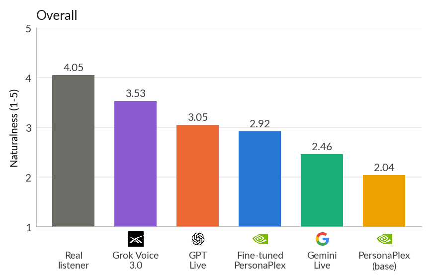
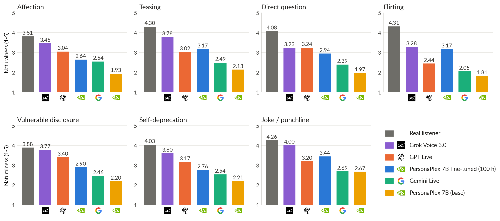

# FRIENDSHIP-BENCH

How natural is a voice model's reaction at the social moments that matter between friends and partners: a tease, a joke,
a flirt, a compliment, a vulnerable disclosure? FRIENDSHIP-BENCH, developed by Liva AI, plays a speaker's real turn from an unscripted
conversation to a real-time speech system and rates what the system says next against what real people said.

- **1,081 moments** from 371 real two-person conversations (friends and romantic partners, English) in the Social-Streaming dataset, in seven types:
  **affection, teasing, direct question, flirting, vulnerable disclosure, self-deprecation, joke / punchline**.
- **Input:** the speaker's audio, from 2 s before the turn to its end, followed by 6 s of silence.
- **Reply:** what the system replies in the 6 s after the speaker's turn (transcribed with ElevenLabs Scribe v2).
- **Score:** each reply is rated individually on a scale of 1 to 5, for how natural and fitting it is from a close friend or partner. Two
  blind LLM judges (GPT-4.1 and Gemini 3.8 Flash, temperature 0) rate based on the speaker's line and the reply. The score takes the mean of the two.
- **Human reference:** the real listener in the original conversation.

## Splits

| Split | Items | Conversations | What is released |
|---|---|---|---|
| public | 806 | 269 | audio, speaker transcripts, real listeners' replies |
| private | 275 | 102 | audio and speaker transcripts; real listeners' replies not released |

All items of one conversation are in the same split (`splits/public.txt`, `splits/private.txt`). 

## Quick start

```bash
pip install -r requirements.txt
# 1. Data (gated: accept the terms on https://huggingface.co/datasets/liva-ai/friendship-bench-data first)
huggingface-cli login
huggingface-cli download liva-ai/friendship-bench-data --repo-type dataset --local-dir data
# 2. Run your system on every item, following PROTOCOL.md (see runners/ for examples)
python runners/make_workdir.py --audio data/audio --work work/my-system
python runners/gpt_live.py --root-dir work/my-system --task listener --concurrency 6 --no-overwrite   # or your own runner (runners/template.py)
# 3. Check the outputs
python check_submission.py --audio data/audio --outputs work/my-system/listener --split public
# 4. Score on the public split (your own API keys: ELEVENLABS_API_KEY, OPENAI_API_KEY, GEMINI_API_KEY)
python scoring/transcribe.py work/my-system/listener
python scoring/rate.py --data data --outputs work/my-system/listener --name my-system --split public
python scoring/rate.py --data data --name real_listener --split public
python scoring/summarize.py --data data --ratings ratings.jsonl
```

## Results



*Mean naturalness (1 to 5) on all 1,081 items.*

By social moment:



Naturalness, 1 to 5 (mean of the two judges), 95 % CI from a bootstrap over conversations.

| System | Private | Public |
|---|---|---|
| Real listener | 4.03 (3.87-4.17) | 4.06 (3.97-4.14) |
| Grok Voice 3.0 (`grok-voice-latest`, Nov 2026) | 3.53 (3.39-3.66) | 3.53 (3.45-3.62) |
| GPT Live (`gpt-live-1`) | 3.14 (2.98-3.29) | 3.02 (2.94-3.11) |
| PersonaPlex 7B fine-tuned on [Social-Streaming](https://huggingface.co/datasets/liva-ai/social-streaming-samples) data | 2.85 (2.67-3.02) | 2.94 (2.84-3.04) |
| Gemini Live (`gemini-3.8-live`) | 2.54 (2.40-2.68) | 2.43 (2.36-2.50) |
| PersonaPlex 7B (`nvidia/personaplex-7b-v1`) | 2.13 (2.01-2.25) | 2.01 (1.94-2.09) |

Public split by moment:

| System | Affection | Teasing | Direct question | Flirting | Vulnerable | Self-deprecation | Joke |
|---|---|---|---|---|---|---|---|
| Real listener | 3.80 | 4.31 | 4.11 | 4.35 | 3.84 | 4.03 | 4.16 |
| Grok Voice 3.0 | 3.48 | 3.80 | 3.20 | 3.30 | 3.69 | 3.51 | 3.90 |
| GPT Live | 3.07 | 3.01 | 3.16 | 2.42 | 3.29 | 3.17 | 3.15 |
| PersonaPlex 7B fine-tuned on [Social-Streaming](https://huggingface.co/datasets/liva-ai/social-streaming-samples) data | 2.66 | 3.20 | 3.00 | 3.23 | 2.86 | 2.65 | 3.35 |
| Gemini Live | 2.54 | 2.43 | 2.25 | 2.07 | 2.52 | 2.62 | 2.61 |
| PersonaPlex 7B | 1.94 | 2.07 | 1.95 | 1.84 | 2.09 | 2.13 | 2.65 |

## Repository

| Path | What |
|---|---|
| `PROTOCOL.md` | how a system must be run so results are comparable |
| `runners/` | the runners used for GPT Live |
| `scoring/` | transcription, reply window, judge rubric, rating and summary |
| `check_submission.py` | checks an outputs folder before scoring |
| `splits/` | item ids of the public and private splits |

## License

The FRIENDSHIP-BENCH evaluation code is licensed under the [MIT License](LICENSE).

The FRIENDSHIP-BENCH dataset is licensed separately under CC BY-ND 4.0.
